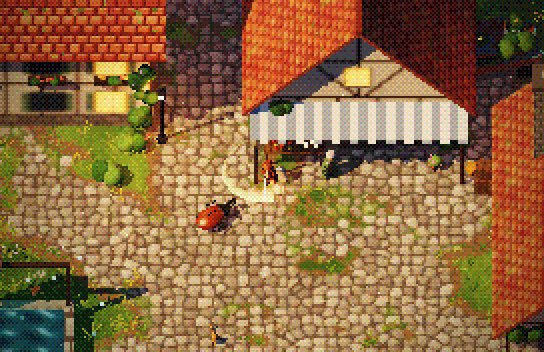
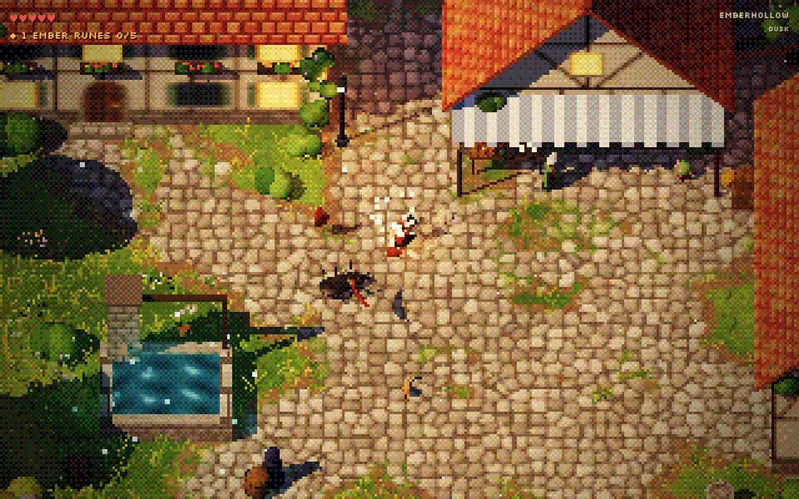

# Emberhollow



A small playable top-down action RPG in pixel art, made with three.js and set in a "mysterious and warm" village at golden hour.
Stag beetles called *shellbacks* crawl out of the woods. Fight them, collect the embers they drop and bring five of them to the sealed gate behind the shop.

**Part 3 of 3:** basketball → 2b-animation → **test-game**

## Run

```sh
python3 -m http.server 8765
```

Then open http://localhost:8765/village.html. There's no build step. three.js `0.160.0` loads from jsdelivr, so you need internet.

| Input | Action |
|---|---|
| WASD / arrows | move |
| J / space / click | attack: a 3-hit combo of two sweeps, then a spin |
| K / shift | roll (you're invulnerable while rolling) |
| E | talk |
| mouse wheel | zoom |

You have 5 hearts. If you hit 0, the lamps carry you home to the square.

## Code layout

The code is plain ES modules with no bundler. Each module builds its part of the world when it's imported, so the import order in `main.js` is also the order the world gets built in.

```
village.html        page shell: HUD markup and styles, the import map, loads src/main.js
src/
  main.js           the frame loop
  stage.js          renderer, scene, fog, follow camera, sun shadows, the low-res + dither pass (vignette, hurt flash, fade)
  util.js           vectors, the seeded random behind the fixed layout, noise, canvas texture helpers
  textures.js       painted roof, stone and plank textures; facade() paints whole half-timbered house fronts
  map.js            cobbled paths, the village edge, collision, the ground texture
  builders.js       mesh helpers and builders: house, tree, bush, hedge, barrel, crate, pot, lantern, sign
  village.js        the layout: houses, shop, well, old carriage, sealed gate, trees, rocks
  foliage.js        instanced leaves, grass tufts that part around you, and flowers, all in one wind
  people.js         the hero, Maren, the stranger and the cat; how the NPCs idle and the cat wanders
  fx.js             particles, slash arcs, debris, the kill flash, and game feel (hit-stop, shake, hurt flash, fade)
  quest.js          HUD, dialogue, banners, what everyone says, ember shards, the gate opening
  input.js          keyboard and mouse
  hero.js           moving, the 3-hit combo, rolling, getting hurt, waking up in the square
  beetles.js        the shellbacks: spawning, AI, getting hit, dying
  ambient.js        fireflies, motes, falling leaves, chimney smoke, flickering lights, sun shafts
```

## What's in it



- **Village:** five timber-framed houses with red tile roofs and smoking chimneys, including Maren's shop and The Tired Lantern inn. There's a cobbled square, a stone well with glowing teal water, an ivy-eaten old car and a ring of forest.
- **Combat:** golden crescent sword arcs, hit-stop, screen shake, sparks, grass clippings and knockback.
- **Enemies:** shellbacks chase you, rear up and charge. When they die, their shells split and fly off, and each one drops an ember that flies to you.
- **Quest:** each ember lights one rune on the sealed gate. After five, the gate opens and the NPCs say new things.
- **NPCs:** Maren the shopkeeper, a hooded stranger with glowing eyes by the well, and a cat that wanders over and sits by you.
- **Atmosphere:** flickering lanterns, fireflies, dust motes, falling leaves, slow sun shafts, violet fog and about 11,000 grass tufts that part around everything that walks through them.

## Inspiration

There were two direct references: a top-down pixel-art village image (timber houses, red roofs, cobbles, a well and a striped shop awning) and a screen recording of a top-down action RPG in which a sword fighter slashes stag beetles.
The path here goes through the other two projects. **basketball** built the pixel/dither renderer and the golden-sun look. **2b-animation** added the rest: the sword fighter, the slash arcs, the sparks, the swaying grass, the sun shafts and enemies that come apart when you hit them. That animation already looked like a game cutscene, so the next step was to make it playable.

## Status

This is a test game, a playable sketch rather than a finished game. There's no sound yet.
